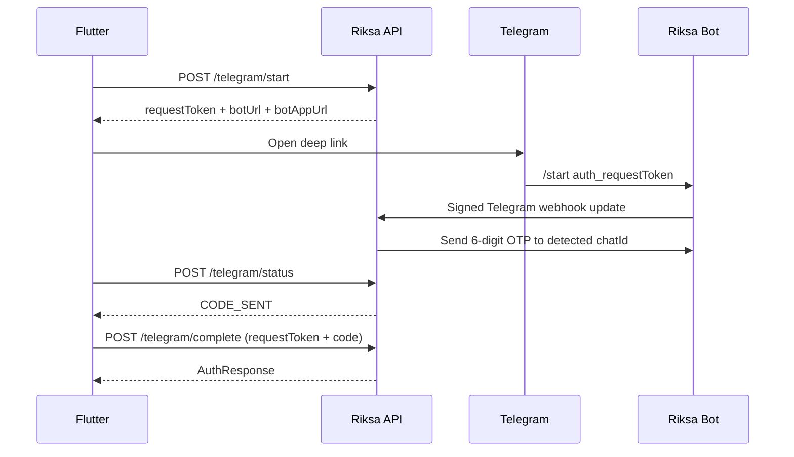

# Flutter Handoff: Telegram Signup, Login, Session Restore, and Account Linking

Last updated: August 17, 2026  
Backend API base: `/api/v1/auth`

This is the implementation contract for the Flutter auth agent. The backend
supports one Telegram button for both signup and login. Flutter never asks the
user for a Telegram chat ID and never sends a chat ID to the API.

## Product behavior

### App startup

1. Read the refresh token from platform secure storage.
2. If it exists, call `POST /refresh`.
3. On success, atomically replace both stored tokens and enter the app.
4. If refresh fails because the token is invalid, expired, or revoked, clear
   both tokens and show the login screen.

This applies to every account type: username/password, Google, and Telegram.

Do not log a user in only because a matching database row exists. Database
existence is not proof that the person holding the phone owns that account.
After an explicit logout, the refresh token is revoked. After reinstall, secure
storage may be gone, so the user must verify again with one of the providers.

### Continue with Telegram

1. Flutter requests a short-lived Telegram auth challenge.
2. Flutter opens the returned Telegram bot deep link.
3. If the user has never used the bot, Telegram displays **Start**. The user
   taps it. Otherwise Telegram immediately sends the `/start` command.
4. Telegram calls the backend webhook. The backend securely obtains and stores
   the Telegram user ID and private chat ID, then sends a six-digit code to that
   chat.
5. Flutter detects `CODE_SENT`, displays the OTP input, and submits the code.
6. The backend logs in the already-linked user or creates a new Riksa account.
7. Flutter stores the returned access and refresh tokens, loads `/me`, and
   enters the app.



## Important account rule

An existing Telegram-linked account is recognized automatically by the stable
Telegram user ID. A first-time Telegram user gets a new Riksa account with a
username and display name derived from the Telegram profile.

Telegram does not provide a verified email address. Therefore, the backend
cannot safely guess that a Telegram user is the same person as an existing
Google or password user. To avoid duplicate accounts:

- after a Google/password user signs in, offer **Link Telegram** in Account or
  Security settings;
- run the same start, bot, status, and code flow;
- call `/telegram/link` instead of `/telegram/complete` for the final step.

After linking once, the user can use either original login method or Telegram.

## API contract

All bodies use `Content-Type: application/json`. Do not log request tokens,
OTPs, access tokens, or refresh tokens.

### 1. Start Telegram auth

`POST /api/v1/auth/telegram/start`

No request body.

Success `200`:

```json
{
  "requestToken": "43-character-base64url-token",
  "botUrl": "https://t.me/riksa_bot?start=auth_...",
  "botAppUrl": "tg://resolve?domain=riksa_bot&start=auth_...",
  "expiresAt": "2026-08-17T15:30:00+07:00",
  "pollAfterSeconds": 3
}
```

Keep `requestToken` in the auth flow state. It expires after 10 minutes by
default. Prefer `botAppUrl`, then fall back to `botUrl` if the Telegram URI
cannot be launched.

### 2. Poll status

`POST /api/v1/auth/telegram/status`

Request:

```json
{
  "requestToken": "43-character-base64url-token"
}
```

Before the user starts the bot:

```json
{
  "status": "PENDING",
  "codeSent": false,
  "accountExists": null,
  "expiresAt": "2026-08-17T15:30:00+07:00"
}
```

After the webhook sends a code:

```json
{
  "status": "CODE_SENT",
  "codeSent": true,
  "accountExists": true,
  "expiresAt": "2026-08-17T15:30:00+07:00"
}
```

Possible status values:

| Status | Flutter behavior |
|---|---|
| `PENDING` | Keep waiting; show “Open Telegram and tap Start.” |
| `CODE_SENT` | Stop polling and show the six-digit code form. |
| `EXPIRED` | Stop polling and offer “Try again.” |
| `COMPLETED` | The request was consumed; do not reuse it. |

Poll every `pollAfterSeconds`, when the app resumes from Telegram, or both.
Stop polling when the widget is disposed, the request expires, or the state is
not `PENDING`.

### 3. Complete signup or login

`POST /api/v1/auth/telegram/complete`

Request:

```json
{
  "requestToken": "43-character-base64url-token",
  "code": "123456"
}
```

Success `200` returns the normal `AuthResponse`:

```json
{
  "userId": "a1b2c3d4-e5f6-4890-abcd-ef1234567890",
  "accessToken": "eyJ...",
  "refreshToken": "eyJ...",
  "tokenType": "Bearer",
  "username": "sophea",
  "role": "USER"
}
```

The same call handles both cases:

- linked Telegram ID found: sign in that user;
- no linked Telegram ID: create the user and its gamification row, then sign in.

An OTP can be attempted at most the configured number of times and a challenge
can be completed only once.

### 4. Link Telegram to a signed-in account

`POST /api/v1/auth/telegram/link`

Headers:

```text
Authorization: Bearer <accessToken>
```

The body is identical to `/telegram/complete`:

```json
{
  "requestToken": "43-character-base64url-token",
  "code": "123456"
}
```

Success `200`:

```json
{
  "message": "Telegram account linked successfully"
}
```

If that Telegram account belongs to a different Riksa user, the API returns
`409 Conflict`. Never fall back to `/complete` after this conflict.

### 5. Telegram webhook — server only

`POST /api/v1/auth/telegram/webhook`

Flutter must never call this endpoint. Telegram calls it with:

```text
X-Telegram-Bot-Api-Secret-Token: <configured secret>
```

The backend accepts only private chats where the sender ID equals the chat ID.
The webhook secret is compared before reading or updating a challenge.

### Legacy endpoints

Do not use these for the new Flutter flow:

- `POST /telegram` — old flow that requires the client to know a chat ID;
- `POST /otp/send` and `POST /otp/verify` — low-level compatibility endpoints.

They remain temporarily available so older work is not broken.

## Flutter implementation outline

Recommended packages:

```yaml
dependencies:
  dio: ^5.0.0
  flutter_secure_storage: ^9.0.0
  url_launcher: ^6.0.0
```

Use the versions selected by the Flutter repository rather than copying these
example constraints blindly.

### API client

```dart
class TelegramAuthStart {
  TelegramAuthStart({
    required this.requestToken,
    required this.botUrl,
    required this.botAppUrl,
    required this.expiresAt,
    required this.pollAfterSeconds,
  });

  final String requestToken;
  final Uri botUrl;
  final Uri botAppUrl;
  final DateTime expiresAt;
  final int pollAfterSeconds;

  factory TelegramAuthStart.fromJson(Map<String, dynamic> json) =>
      TelegramAuthStart(
        requestToken: json['requestToken'] as String,
        botUrl: Uri.parse(json['botUrl'] as String),
        botAppUrl: Uri.parse(json['botAppUrl'] as String),
        expiresAt: DateTime.parse(json['expiresAt'] as String),
        pollAfterSeconds: json['pollAfterSeconds'] as int,
      );
}

class TelegramAuthApi {
  TelegramAuthApi(this._dio);
  final Dio _dio;

  Future<TelegramAuthStart> start() async {
    final response = await _dio.post('/api/v1/auth/telegram/start');
    return TelegramAuthStart.fromJson(response.data as Map<String, dynamic>);
  }

  Future<Map<String, dynamic>> status(String requestToken) async {
    final response = await _dio.post(
      '/api/v1/auth/telegram/status',
      data: {'requestToken': requestToken},
    );
    return response.data as Map<String, dynamic>;
  }

  Future<Map<String, dynamic>> complete(
    String requestToken,
    String code,
  ) async {
    final response = await _dio.post(
      '/api/v1/auth/telegram/complete',
      data: {'requestToken': requestToken, 'code': code},
    );
    return response.data as Map<String, dynamic>;
  }

  Future<void> link(
    String accessToken,
    String requestToken,
    String code,
  ) async {
    await _dio.post(
      '/api/v1/auth/telegram/link',
      data: {'requestToken': requestToken, 'code': code},
      options: Options(headers: {'Authorization': 'Bearer $accessToken'}),
    );
  }
}
```

### Launch Telegram

```dart
Future<void> openTelegram(TelegramAuthStart auth) async {
  final openedApp = await launchUrl(
    auth.botAppUrl,
    mode: LaunchMode.externalApplication,
  );
  if (!openedApp) {
    final openedWeb = await launchUrl(
      auth.botUrl,
      mode: LaunchMode.externalApplication,
    );
    if (!openedWeb) throw StateError('Could not open Telegram');
  }
}
```

Treat launching the URL as navigation, not proof of authentication. Only the
successful `/complete` response establishes a session.

### Suggested state machine

```text
idle
  -> starting
  -> waitingForBot
  -> codeSent
  -> verifyingCode
  -> authenticated

Any active state -> expired | recoverableError
```

Keep the request token and expiry inside the auth controller/BLoC/Riverpod
notifier. Cancel the polling timer in `dispose`. When app lifecycle changes to
`resumed`, immediately check status once instead of waiting for the next timer.

### Secure token persistence and restore

Store both tokens with `flutter_secure_storage`. A refresh rotates the refresh
token, so write both returned values together before issuing another request.

```dart
Future<bool> restoreSession() async {
  final refreshToken = await secureStorage.read(key: 'refresh_token');
  if (refreshToken == null) return false;

  try {
    final response = await dio.post(
      '/api/v1/auth/refresh',
      data: {'refreshToken': refreshToken},
    );
    await saveAuthResponse(response.data as Map<String, dynamic>);
    return true;
  } on DioException catch (error) {
    if (error.response?.statusCode == 400 ||
        error.response?.statusCode == 401) {
      await clearStoredSession();
      return false;
    }
    rethrow; // Network outage is not proof that the session is invalid.
  }
}
```

On logout, call `/logout` with the refresh token and clear local tokens in a
`finally` block. Do not auto-login immediately after an explicit logout.

## UX requirements

- Use one button labeled **Continue with Telegram**, not separate Telegram
  signup and login buttons.
- While `PENDING`, show instructions to tap **Start** in Telegram and return to
  Riksa.
- When `CODE_SENT`, show a numeric six-digit input with paste/autofill support.
- Keep **Resend** as “Start again”; request a new challenge instead of reusing
  an expired one.
- Never ask for Telegram username, Telegram user ID, or chat ID.
- Never display `accountExists` as an account-enumeration message. It may be
  used internally for analytics or wording after the Telegram user has already
  interacted with the bot.
- After first Telegram signup, load `/me` and optionally offer normal profile
  completion (email, province, gender, and avatar).

## Error handling

| HTTP/status | Meaning | Flutter action |
|---|---|---|
| `400` | Invalid/expired token, code, or validation | Show message; offer restart if expired |
| `403` | Suspended account or invalid authenticated action | Do not create another account |
| `409` | Bot not started yet, Telegram disabled/misconfigured, or link conflict | Show API message; preserve safe state |
| `429` | Start/complete auth rate limit | Disable retry briefly and show countdown |
| `5xx` | Temporary server or Telegram delivery failure | Preserve challenge until expiry and allow retry |

Use the API's `message` field for diagnostics, but map it to localized Khmer or
English UI copy rather than showing raw backend text everywhere.

## Backend deployment setup

Required environment variables:

```dotenv
TELEGRAM_ENABLED=true
TELEGRAM_BOT_TOKEN=<token from BotFather>
TELEGRAM_BOT_USERNAME=<username without or with @>
TELEGRAM_WEBHOOK_URL=https://api.example.com/api/v1/auth/telegram/webhook
TELEGRAM_WEBHOOK_SECRET=<long random secret>
TELEGRAM_AUTH_REQUEST_EXPIRATION_MINUTES=10
```

Generate a webhook secret, for example:

```bash
openssl rand -hex 32
```

The webhook URL must be public HTTPS. `localhost` cannot receive Telegram
updates. For local development, use a controlled HTTPS tunnel and set its full
webhook endpoint URL. On application startup, the backend calls Telegram's
`setWebhook` when `TELEGRAM_WEBHOOK_URL` is configured. It restricts updates to
`message` and supplies the configured secret token.

Never commit the bot token or webhook secret. Never include either value in
Flutter—the bot token and webhook secret are server-only credentials.

## Acceptance checklist

- [ ] Fresh install with no token shows the login screen.
- [ ] Existing refresh token rotates and restores any provider session.
- [ ] Explicit logout revokes refresh and returns to login.
- [ ] Telegram installed: app URI opens the correct bot and payload.
- [ ] Telegram not installed: HTTPS bot URL opens successfully.
- [ ] First bot use displays Start, sends the code, and creates one Riksa user.
- [ ] Later Telegram login returns the same Riksa `userId`.
- [ ] A wrong code is rejected and attempts are limited.
- [ ] An expired or completed challenge cannot be reused.
- [ ] Password/Google account can link Telegram while authenticated.
- [ ] Telegram already linked to another user returns `409` and never creates a duplicate.
- [ ] Polling stops on dispose, completion, and expiry.
- [ ] No secret or token appears in logs, analytics, crash reports, or screenshots.

